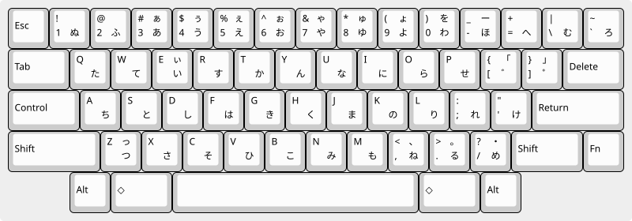
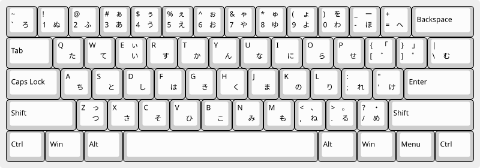

# tu.el

## 概要

tu.el は
[ひらがなIME](https://esrille.github.io/ibus-hiragana/index.html)
([esrille/ibus-hiragana](https://github.com/esrille/ibus-hiragana))
にインスパイアされた Emacs 用のインプットメソッドです。

- QWERTY 配列上の USかな入力をサポートしています
- ひらがなは、確定的に入力されます
- 漢字変換は、単語単位の後置変換で行います
- 漢字変換には Emacs に標準添付の kkc を利用しています
  - Emacs 内で完結しており、インターネットなど外部と通信することはありません

## USかな配列

USかな配列は、JISかな配列を英語キーボード用にアレンジした配列です。

- `「`/`」` (かぎ括弧) は `[`/`]` (square bracket) に合わせて横並びに配置
- `ー` (長音記号) は `Shift+ほ` の位置にある `_` (underscore) で入力
- `む` や `ろ` のキー `\` (backslash) や `` ` `` (grave accent) の位置は、キーボードによって異なるかもしれません

### [Happy Hacking Keyboard](https://happyhackingkb.com/jp/) 英語配列



### 一般的な英語配列キーボード



## インストールとセットアップ

tu.el を `load-path` の通ったところに置いて init.el に次のように書きます。

``` emacs-lisp
(when (require 'tu nil t)
  (setq default-input-method "tu"))
```

- `C-\` (`toggle-input-method`) で、日本語入力モードが ON になります
  - モードラインの左端に `かな` という表示が現れます
- 再度 `C-\` とすると、日本語入力モードが OFF になります

## 入力方法

### ひらがな

- タイプしたキーはひらがなに変換されて直接入力されます。未確定文字列にはなりません

### 漢字

- `SPC` で、カーソルのすぐ左のひらがなの単語を漢字に変換します (後置変換)
- `SPC`/`C-n` または `C-p` で、候補を選択し `RET` で確定します
- `TAB`/`C-i` で、読みを 1文字ずつ縮めます。縮めすぎた場合は `S-TAB` で伸ばせます
  - `生きがいろん` `SPC` → `生き概論` `TAB` → `生きが異論` `TAB` → `生きがい論`
- 前置数引数で、読みの文字数を指定して変換することもできます
  - `生きがいろん` `M-2 SPC` → `生きがい論`
- 送りがなのある語は、1文字だけ送って変換します
  - `おこなっ` `SPC` → `行っ`
  - `おこな` `SPC` → `行な`

### かたかな

- `SPC` で漢字変換中に `C-k` で、かたかなに変換します
- 続けて `C-k` で、かたかなのまま 1文字ずつ伸ばします
  - `かたかな` `SPC` → `片仮名` `C-k` → `カタカナ`
  - `いんぷっと` `M-5 SPC` `C-k` → `インプット`
  - `いんぷっと` `SPC` → `いんぷっ戸` `C-k C-k C-k C-k C-k` → `インプット`

## キーバインド

入力中は、次のキー操作が可能です。

| キー  | 意味       |
|:------|:-----------|
| `SPC` | 変換を開始 |

変換中は、次のキー操作が可能です。

| キー             | 意味             |
|:-----------------|:-----------------|
| `C-n`, `SPC`     | 次の候補         |
| `C-p`            | 前の候補         |
| `C-l`            | 次の候補群       |
| `C-S-l`          | 前の候補群       |
| `C-0` .. `C-9`   | 候補群から選択   |
| `C-k`            | かたかなに変換   |
| `C-i`, `TAB`     | 文節を縮める     |
| `C-S-i`, `S-TAB` | 文節を伸ばす     |
| `C-c`, `C-g`     | 変換をキャンセル |
| `C-m`, `RET`     | 変換を確定       |
| `C-h`            | ヘルプ           |

## 既知の問題

- 日本語モードでは `SPC` は変換キーになるので、ひらがなの直後で空白を入力できません。
  `C-q SPC` とするか、 `S-SPC` (`tu-shift-space`) とするか、日本語モードを OFF にしてから `SPC` をタイプするなどする必要があります
- isearch (`C-s`) では、漢字変換ができず、ひらがなしか検索できません
  - nonincremental search (`C-s RET`) では、漢字変換ができます
- 変換辞書に単語登録することができません
- 変換辞書にない単語 (かたかな語など) の履歴学習を行いません

----

## 実験的機能

### かたかな語辞書 ja-dic-katakana.el の利用

- kkc が使用する辞書 ja-dic.el は、かたかな語が少なく、 tu.el では、外来語などのかたかなの入力に手間がかかります
- そこで、標準の ja-dic.el (の送りなしエントリ) の補遺として、 [SKK-JISYO.L](https://skk-dev.github.io/dict/) の abbrev エントリのかたかな語を収録した ja-dic-katakana.el (を作成するスクリプト) を用意しました
- kkc のキャッシュファイル kkcrc を (バックアップを取ったうえで) 削除し、 ja-dic-katakana.el をバイトコンパイルして、 tu.el と同じディレクトリ (`load-path` の通ったところ) に置いておくと、有効化されます

``` shellsession
cd ja-dic-katakana
cat SKK-JISYO.L | ./make_sek.sh | ./make_skk-okuri-nasi-katakana_el.rb > ../ja-dic-katakana.el
cd ..
emacs -batch -L . -f batch-byte-compile ja-dic-katakana.el
```

### 濁点・半濁点後置による記号入力

次の文字に濁点を付けることで、矢印記号が入力できます。

| 文字           | 記号           | 備考               |
|:---------------|:---------------|:-------------------|
| `に`           | `↑`           | 逆T字カーソル      |
| `ま` `の` `り` | `←` `↓` `→` | 〃 (vi とは異なる) |
| `め`           | `゛`           | `・`               |

また、次の文字に半濁点を付けることで、その他の記号が入力できます。

| 文字 | 記号 | 備考         |
|:-----|:-----|:-------------|
| `ゆ` | `〒` | ゆうびん     |
| `む` | `￥` | `\`          |
| `た` | `—` | ダッシュ     |
| `て` | `…` | てんてん     |
| `な` | `〜` | なみダッシュ |
| `と` | `℃` | ど (度)      |
| `し` | `〆` | しめ         |
| `く` | `ゝ` | くりかえし   |
| `ま` | `々` | ノマ         |
| `の` | `〃` | ノノ         |
| `こ` | `※` | こめ (米)    |
| `め` | `゜` | `・`         |

### 一時入力 (Transient input)

- 日本語モードで `S-無変換` (`tu-transient`) をタイプするか、すばやく `無変換` (`tu-ascii-or-transient`) を連打すると、 1 文字だけ ASCII 文字を入力できます

### かたかな置換

- 日本語モードで `S-変換` (`tu-katakana-backward`) をタイプすると、カーソルの左のひらがなを 1文字ずつかたかなに置換します
  - `もーど` `S-変換` → `もード` `S-変換` → `モード`
  - `たいぷ` `M-3 S-変換` → `タイプ`

### かたかなモード

- 日本語モードで `C-変換` (`tu-toggle-katakana`) をタイプすると、かたかなモードをトグルします
- または、日本語モードで、すばやく `変換` (`tu-hiragana-or-katakana`) を連打すると、かたかなモードになります
- モード表示は `カナ` です
- かたかなモードでは、入力したかなはかたかなとして確定入力されます
- `SPC` は、変換の開始ではなく、空白の入力になります
- `変換` をタイプすると、ひらがなモードに戻ります

### ASCII モード

- 日本語モード中で `C-無変換` (`tu-switch-ascii`) をタイプすると、 ASCII モードになります
- または、日本語モードで、`無変換` (`tu-ascii-or-transient`) をタイプすると、 ASCII モードになります
- モード表示は `英数` です
- ASCII モードでは、タイプしたキーは英数字のままバッファに入力されます
- `変換` をタイプすると、ひらがなモードに戻ります

----

## ライセンス

> This program is free software; you can redistribute it and/or modify
> it under the terms of the GNU General Public License as published by
> the Free Software Foundation, either version 3 of the License, or
> (at your option) any later version.
>
> This program is distributed in the hope that it will be useful,
> but WITHOUT ANY WARRANTY; without even the implied warranty of
> MERCHANTABILITY or FITNESS FOR A PARTICULAR PURPOSE.  See the
> GNU General Public License for more details.
>
> You should have received a copy of the GNU General Public License
> along with this program.  If not, see <https://www.gnu.org/licenses/>.
